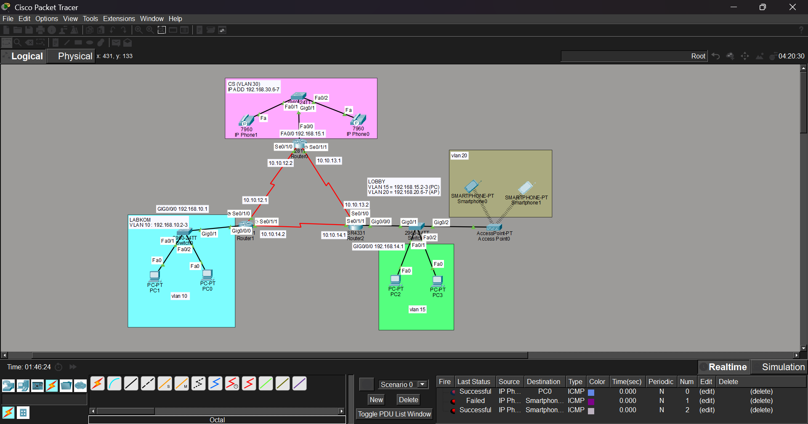

# Multi-VLAN OSPF Topology with IP Telephony

A multi-site network lab built in Cisco Packet Tracer. Three routers exchange routes using single-area OSPF over a redundant serial triangle, while each site runs its own VLAN. One router doubles as a Cisco CME telephony server for IP phones.



## Overview

| Component | Details |
|---|---|
| Routing | OSPF process 1, all routers in area 0 |
| Inter-router links | Serial, /30 subnets, full triangle for redundancy |
| Sites | Lab (VLAN 10), Lobby (VLAN 15 and 20), CS (VLAN 30) |
| Services | DHCP, wireless access point, IP telephony (Cisco CME) |
| Devices | 1x Cisco 2811, 2x ISR4331, 2960 switches, 7960 IP phones |

## Addressing

### Router-to-router links

| Link | Subnet | Side 1 | Side 2 |
|---|---|---|---|
| R1 to R0 | 10.10.12.0/30 | R1: 10.10.12.1 | R0: 10.10.12.2 |
| R0 to R2 | 10.10.13.0/30 | R0: 10.10.13.1 | R2: 10.10.13.2 |
| R1 to R2 | 10.10.14.0/30 | R2: 10.10.14.1 | R1: 10.10.14.2 |

### LANs

| Site | VLAN | Subnet | Hosts | Addressing |
|---|---|---|---|---|
| Lab (R1) | 10 | 192.168.10.0/24 | 2 PCs | Static |
| Lobby PCs (R2) | 15 | 192.168.15.0/24 | 2 PCs | Static |
| Lobby WiFi (R2) | 20 | 192.168.20.0/24 | Access point + 2 smartphones | DHCP (.2 - .5) |
| CS (R0) | 30 | 192.168.30.0/24 | 2 IP phones | DHCP |

### OSPF router IDs

| Router | Router ID |
|---|---|
| R1 | 3.3.3.3 |
| R0 | 4.4.4.4 |
| R2 | 5.5.5.5 |

## How It Works

**OSPF.** Every router runs OSPF process 1 and places all interfaces in area 0. Neighbors form over the serial links and reach the FULL state. Because the links form a triangle, each router has two paths to every other subnet, and OSPF picks the lowest cost and reroutes automatically if a link fails.

**Passive interfaces.** LAN-facing interfaces are set to passive. They still advertise their subnets, but no OSPF Hello packets are sent toward end devices, which reduces unnecessary traffic and prevents rogue OSPF neighbors on user ports.

**VLANs on R1 (single VLAN).** The Lab has only one VLAN, so the switch port facing the router is an access port in the same VLAN as the PCs, and the router interface carries the gateway IP directly with no encapsulation.

**VLANs on R2 (multiple VLANs).** The Lobby has two VLANs sharing one cable, so the switch port facing the router is a trunk and R2 uses router-on-a-stick: one `dot1Q` subinterface per VLAN, each holding that VLAN's gateway.

**DHCP.** R2 hands out addresses for VLAN 20. R0 hands out addresses for the IP phones and includes option 150 so phones can find the call server.

**IP telephony.** R0 runs Cisco CME (`telephony-service`). Phones register to R0, receive extension numbers, and can call each other across the OSPF network.

## Configuration

Full files are also in the [`config/`](config/) folder.

<details>
<summary><b>R1 (ISR4331) - Lab, VLAN 10</b></summary>

```
hostname R1

interface GigabitEthernet0/0/0
 description LAN Lab (VLAN 10, switch port = access)
 ip address 192.168.10.1 255.255.255.0
 no shutdown

interface Serial0/1/0
 description Link to R0
 ip address 10.10.12.1 255.255.255.252
 no shutdown

interface Serial0/1/1
 description Link to R2
 ip address 10.10.14.2 255.255.255.252
 no shutdown

router ospf 1
 router-id 3.3.3.3
 network 10.10.12.0 0.0.0.3 area 0
 network 10.10.14.0 0.0.0.3 area 0
 network 192.168.10.0 0.0.0.255 area 0
 passive-interface GigabitEthernet0/0/0
```
</details>

<details>
<summary><b>R2 (ISR4331) - Lobby, VLAN 15 and 20</b></summary>

```
hostname R2

interface GigabitEthernet0/0/0
 description Trunk to lobby switch
 no ip address
 no shutdown

interface GigabitEthernet0/0/0.15
 description VLAN 15 (PCs)
 encapsulation dot1Q 15
 ip address 192.168.15.1 255.255.255.0

interface GigabitEthernet0/0/0.20
 description VLAN 20 (access point)
 encapsulation dot1Q 20
 ip address 192.168.20.1 255.255.255.0

interface Serial0/1/0
 description Link to R0
 ip address 10.10.13.2 255.255.255.252
 no shutdown

interface Serial0/1/1
 description Link to R1
 ip address 10.10.14.1 255.255.255.252
 no shutdown

router ospf 1
 router-id 5.5.5.5
 network 10.10.13.0 0.0.0.3 area 0
 network 10.10.14.0 0.0.0.3 area 0
 network 192.168.15.0 0.0.0.255 area 0
 network 192.168.20.0 0.0.0.255 area 0
 passive-interface GigabitEthernet0/0/0.15
 passive-interface GigabitEthernet0/0/0.20

ip dhcp excluded-address 192.168.20.1
ip dhcp excluded-address 192.168.20.6 192.168.20.254
ip dhcp pool LOBBY-VLAN20
 network 192.168.20.0 255.255.255.0
 default-router 192.168.20.1
```
</details>

<details>
<summary><b>R0 (2811) - CS, VLAN 30 and telephony</b></summary>

```
hostname R0-TELEPHONY

interface FastEthernet0/0
 description LAN CS (IP phones)
 ip address 192.168.30.1 255.255.255.0
 no shutdown

interface Serial0/1/0
 description Link to R1
 ip address 10.10.12.2 255.255.255.252
 no shutdown

interface Serial0/1/1
 description Link to R2
 ip address 10.10.13.1 255.255.255.252
 no shutdown

router ospf 1
 router-id 4.4.4.4
 network 10.10.12.0 0.0.0.3 area 0
 network 10.10.13.0 0.0.0.3 area 0
 network 192.168.30.0 0.0.0.255 area 0
 passive-interface FastEthernet0/0

ip dhcp excluded-address 192.168.30.1 192.168.30.5
ip dhcp pool PHONE
 network 192.168.30.0 255.255.255.0
 default-router 192.168.30.1
 option 150 ip 192.168.30.1

telephony-service
 max-ephones 5
 max-dn 5
 ip source-address 192.168.30.1 port 2000
 auto assign 1 to 5

ephone-dn 1
 number 1001
ephone-dn 2
 number 1002

ephone 1
 mac-address <MAC of IP Phone0>
 button 1:1
ephone 2
 mac-address <MAC of IP Phone1>
 button 1:2
```
</details>

On the serial links, one side of each cable is the DCE end and needs `clock rate 64000` on its interface.

## Verification

```
show ip ospf neighbor     ! two neighbors per router, state FULL
show ip route ospf        ! O routes to every remote subnet
show ip protocols         ! confirm passive interfaces
ping <remote PC>          ! end-to-end connectivity
show ephone registered    ! on R0, phones should be registered
```

**Failover test:** run `shutdown` on one serial interface and ping again. Traffic should continue over the remaining path.

## Repository Structure

```
topologi-ospf/
├── topologi-ospf.pkt        Packet Tracer file
├── topologi.png             Topology screenshot
├── README.md
└── config/
    ├── router0-telephony.txt
    ├── router1.txt
    └── router2.txt
```

## Usage

1. Install Cisco Packet Tracer.
2. Download this repository (Code, then Download ZIP).
3. Open `topologi-ospf.pkt`.
4. Open any router's CLI tab and run the verification commands above.

## Author

[YAWUAN](https://github.com/YAWUAN), Computer and Network Engineering student.
